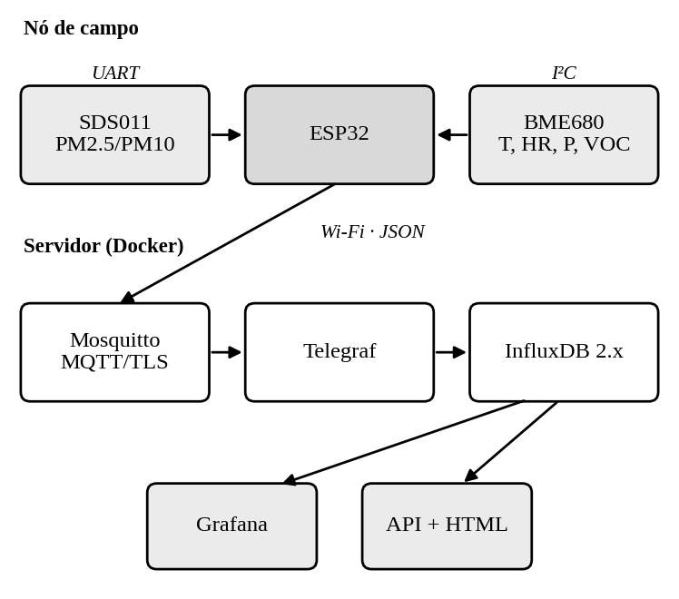
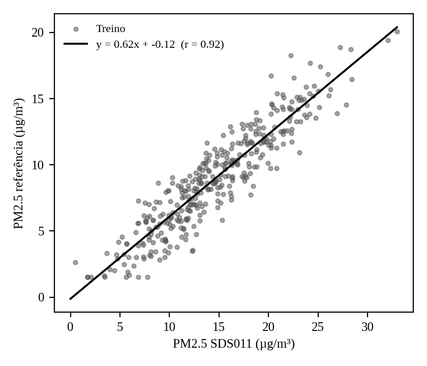
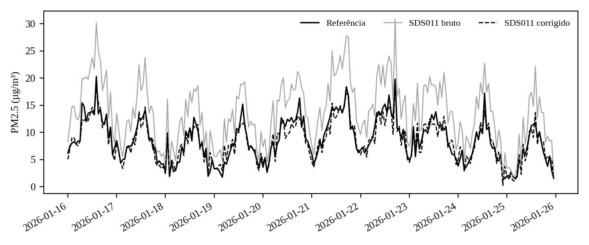
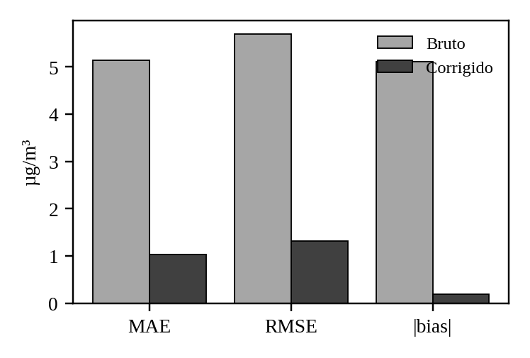

# Estação de Monitorização Ambiental de Baixo Custo

### Desenvolvimento, Calibração e Validação de um Sistema Descentralizado para Ciência Cidadã

[](https://doi.org/10.5281/zenodo.23157287)


**Autor:** Luís Filipe Cunha Gonçalves — Investigador independente — Amora, Setúbal, Portugal
**ORCID:** [0009-0001-0832-7425](https://orcid.org/0009-0001-0832-7425)
**Relatório completo:** [`docs/relatorio.pdf`](docs/relatorio.pdf) · **Registo Zenodo:** https://doi.org/10.5281/zenodo.23157287

---

## Resumo

A monitorização ambiental local complementa as redes oficiais, que têm cobertura espacial limitada. Este projeto implementa uma estação de baixo custo, aberta e reprodutível, baseada no microcontrolador **ESP32** e em dois sensores comerciais: o **SDS011** (partículas PM2.5 e PM10) e o **BME680** (temperatura, humidade relativa, pressão e compostos orgânicos voláteis).

Os dados são enviados por **MQTT com TLS**, armazenados em **InfluxDB 2.x**, visualizados em **Grafana** e disponibilizados através de uma **API REST** (FastAPI) e de exportação em CSV, em conformidade com os princípios **FAIR**. Define-se também um protocolo de calibração do SDS011 por regressão linear face a uma estação de referência, com validação cruzada temporal e estimativa de incerteza segundo o GUM.

> ⚠️ **Nota de honestidade científica** (herdada do relatório original): a estação foi desenvolvida e testada em Amora (Setúbal), mas a **campanha de colocalização e calibração real ainda não foi realizada**. Os resultados de calibração mostrados abaixo usam **dados sintéticos**, gerados pelo próprio script (`calibracao/calibracao.py --demo`), e servem apenas para demonstrar o método. Não devem ser lidos como desempenho real do sensor.

## Índice

1. [Arquitetura do sistema](#arquitetura-do-sistema)
2. [Firmware](#firmware)
3. [Calibração e validação](#calibração-e-validação)
4. [Estrutura do repositório](#estrutura-do-repositório)
5. [Instalação e utilização](#instalação-e-utilização)
6. [Lista de materiais](#lista-de-materiais)
7. [Dados abertos e API](#dados-abertos-e-api)
8. [Segurança](#segurança)
9. [Limitações e trabalho futuro](#limitações-e-trabalho-futuro)
10. [Como citar](#como-citar)
11. [Licenças](#licenças)
12. [Referências](#referências)

---

## Arquitetura do sistema

A estação segue um modelo em camadas — **aquisição → comunicação → armazenamento → visualização/disseminação** — em que cada camada pode ser substituída sem alterar as restantes.

<p align="center">
  
  <br><sub><b>Fig. 1.</b> Arquitetura do sistema: do nó de campo ao servidor e à disseminação dos dados.</sub>
</p>

**Nó de campo.** O ESP32 (dois núcleos a 240 MHz, 520 KB SRAM, 4 MB flash) agrega o SDS011 (laser, 0–999 µg/m³, exatidão nominal ±10 µg/m³, UART a 9600 bit/s) e o BME680 (I²C, endereço `0x77`/`0x76`).

| Sinal | Origem → destino | Observações |
|---|---|---|
| UART (9600 bit/s) | SDS011 TX → GPIO16; SDS011 RX ← GPIO17 | Alimentação 5 V; consumo típico ≈ 70 mA (máx. ≈ 100 mA) |
| I²C | BME680 SDA → GPIO21; SCL → GPIO22 | Alimentação 3,3 V; endereço `0x77` |
| Alimentação | USB 5 V ou LiPo + regulador | SDS011 em modo de repouso entre leituras |

**Comunicação.** MQTT com TLS (porta 8883). O nó publica, a cada 60 s, uma única mensagem JSON no tópico `amora/setubal/estacao01/medicoes`, com `pm25`, `pm10`, `temperatura`, `humidade`, `pressao`, `gas_kohm`, os valores brutos de PM e o RSSI — garantindo que todas as grandezas de um ciclo partilham o mesmo instante.

**Armazenamento e visualização.** O Telegraf subscreve o tópico MQTT e escreve no InfluxDB 2.x (retenção de 365 dias; *measurement* `qualidade_ar`, *tags* `local` e `estacao`). O Grafana apresenta séries temporais de PM, temperatura, humidade e pressão, e a comparação entre PM2.5 bruto e corrigido. O painel público é só de leitura; a administração exige autenticação.

## Firmware

`firmware/estacao_ambiental.ino`, em C++ para o Arduino core do ESP32, executa um ciclo de 60 s: acorda o SDS011 e aguarda 30 s para estabilizar o fluxo de ar → calcula a média de 5 leituras e volta a colocar o sensor em repouso (prolonga a vida útil do laser) → lê o BME680 → aplica os coeficientes de calibração `A`/`B` → publica o JSON por MQTT/TLS com a hora UTC (NTP). Os valores brutos são sempre publicados, o que permite recalibrar o histórico.

Descodificação da trama de 10 bytes do SDS011 (cabeçalho `0xAA`, comando `0xC0`, dados, soma de controlo, cauda `0xAB`), com validação da soma antes de aceitar a leitura:

```cpp
if (b[1] == 0xC0 && b[9] == 0xAB) {
  uint8_t cs = (b[2]+b[3]+b[4]+b[5]+b[6]+b[7]) & 0xFF;
  if (cs == b[8]) {
    pm25 = ((b[3] << 8) | b[2]) / 10.0f;
    pm10 = ((b[5] << 8) | b[4]) / 10.0f;
  }
}
```

Bibliotecas: **PubSubClient**, **Adafruit BME680** (+ Adafruit Unified Sensor), **ArduinoJson 7.x**. Placa: *ESP32 Dev Module*.

## Calibração e validação

Protocolo para o SDS011, em quatro fases, comparando com uma estação de referência (em Portugal: rede **QualAr**/APA para partículas, **IPMA** para meteorologia; método gravimétrico **EN 12341** ou equivalente):

| Fase | Duração | Resultado |
|---|---|---|
| 1 — Colocalização | 15 dias | Série horária emparelhada |
| 2 — Correlação (regressão linear, coeficiente de Pearson *r*) | 1 dia | *r* ≥ 0,85 aceitável · 0,80–0,85 marginal · < 0,80 investigar sensor |
| 3 — Correção: `PM2.5_corr = A · PM2.5_med + B` | — | Coeficientes `A`, `B` → `config.h` |
| 4 — Validação (período independente, 10–15 dias) | 10–15 dias | MAE, RMSE, *bias* |

**Incerteza (GUM):** combinam-se em quadratura a incerteza da calibração (σ_cal, resíduo da regressão), a repetibilidade (σ_rep, 10 leituras consecutivas) e a incerteza da referência (σ_ref):

```
U = 2 · √(σ_cal² + σ_rep² + σ_ref²)      (k = 2, ≈95% de confiança)
```

### Exemplo ilustrativo (dados sintéticos — `calibracao/calibracao.py --demo`)

600 horas de dados sintéticos, 60% para treino, com um SDS011 simulado que sobrestima a referência:

<p align="center">
  
  <br><sub><b>Fig. 2.</b> Regressão linear SDS011 vs. referência (fase de treino): A = 0,62, B = −0,12, r = 0,92.</sub>
</p>

<p align="center">
  
  <br><sub><b>Fig. 3.</b> Validação na janela dos 40% restantes: referência, SDS011 bruto e corrigido.</sub>
</p>

| Métrica (µg/m³) | Bruto | Corrigido |
|---|---|---|
| MAE | 5,13 | 1,02 |
| RMSE | 5,70 | 1,31 |
| *Bias* | 5,12 | −0,19 |

<p align="center">
  
  <br><sub><b>Fig. 4.</b> Comparação das métricas antes e depois da correção. Incerteza expandida U = ±3,7 µg/m³.</sub>
</p>

Critérios de validação para as variáveis climáticas do BME680:

| Variável | Referência | Diferença aceitável |
|---|---|---|
| Temperatura | Termómetro digital certificado | < 1 °C |
| Humidade | Psicrómetro ou sensor calibrado | < 5 % HR |
| Pressão | Dados do IPMA (corrigidos à altitude local) | < 1 hPa |

## Estrutura do repositório

```
.
├── firmware/      estacao_ambiental.ino, config.h
├── infra/         docker-compose.yml, .env.example, mosquitto/, telegraf/, grafana/
├── api/           api.py, Dockerfile, requirements.txt
├── web/           index.html (painel público)
├── calibracao/    calibracao.py
└── docs/          relatorio.pdf, img/ (figuras deste README)
```

## Instalação e utilização

### 1. Servidor (Docker)

```bash
cd infra
cp .env.example .env            # preencher palavras-passe e token (openssl rand -hex 32)

# Certificados TLS (autoridade própria; substituir CN pelo nome/IP do servidor)
mkdir -p certs && cd certs
openssl genrsa -out ca.key 4096
openssl req -x509 -new -key ca.key -days 1825 -subj "/CN=Estacao-CA" -out ca.crt
openssl genrsa -out server.key 2048
openssl req -new -key server.key -subj "/CN=mqtt.exemplo.pt" -out server.csr
openssl x509 -req -in server.csr -CA ca.crt -CAkey ca.key -CAcreateserial -days 825 \
  -extfile <(printf "subjectAltName=DNS:mqtt.exemplo.pt") -out server.crt
cd ..

# Utilizadores MQTT (um para a estação, outro para o Telegraf)
touch mosquitto/passwd
docker run --rm -v "$PWD/mosquitto:/m" eclipse-mosquitto:2 mosquitto_passwd -b /m/passwd estacao01 PALAVRA_PASSE_MQTT
docker run --rm -v "$PWD/mosquitto:/m" eclipse-mosquitto:2 mosquitto_passwd -b /m/passwd telegraf  PALAVRA_PASSE_TELEGRAF

docker compose up -d
```

- Grafana: `http://servidor:3000` (painel "Estação Ambiental — Amora, Setúbal" já provisionado)
- Painel web + API: `http://servidor:8000` (`/api/dados`, `/api/export.csv`, `/api/ultimo`)
- A palavra-passe do Telegraf em `.env` (`MQTT_TELEGRAF_PASSWORD`) tem de ser igual à definida acima.

### 2. Firmware

No Arduino IDE, instalar o suporte **ESP32** e as bibliotecas **PubSubClient**, **Adafruit BME680 Library** (+ Adafruit Unified Sensor) e **ArduinoJson 7.x**. Editar `firmware/config.h` (Wi-Fi, broker, pinos) e carregar para a placa **"ESP32 Dev Module"**.

Em produção, substituir `rede.setInsecure()` por `rede.setCACert(<conteúdo de ca.crt>)` para validar o certificado do broker.

Testar com: `mosquitto_sub -h servidor -p 8883 --cafile ca.crt -u telegraf -P ... -t "amora/setubal/+/medicoes"`

### 3. Calibração

```bash
pip install pandas numpy matplotlib
python calibracao/calibracao.py --demo                       # só demonstração (dados sintéticos)
python calibracao/calibracao.py --estacao estacao.csv --ref referencia.csv
```

Copiar `A`/`B` para `CAL_PM25_A`/`CAL_PM25_B` em `config.h` e recarregar o firmware. Como o valor bruto (`pm25_raw`) continua a ser guardado, a recalibração pode ser aplicada também ao histórico.

## Lista de materiais

| Componente | Função | Quantidade |
|---|---|---|
| ESP32 DevKit (30 ou 38 pinos) | Microcontrolador e Wi-Fi | 1 |
| SDS011 com tubo de entrada | PM2.5 e PM10 | 1 |
| BME680 (módulo I²C) | Temperatura, humidade, pressão, VOC | 1 |
| Fonte USB 5 V / 2 A | Alimentação | 1 |
| Caixa de proteção (abrigo contra radiação e chuva) | Instalação exterior | 1 |
| Cabos Dupont + resistências de pull-up I²C (se necessário) | Ligações | — |

*(Preços omitidos; variam consoante o fornecedor.)*

## Dados abertos e API

| Endpoint | Descrição |
|---|---|
| `GET /api/dados?inicio=&fim=&agregacao=` | Série temporal em JSON (agregação `10m`, `1h`, `1d`, …) |
| `GET /api/export.csv?inicio=&fim=&agregacao=` | Exportação em CSV |
| `GET /api/ultimo` | Última medição (janela de 3 h) |
| `GET /` | Painel web público (`web/index.html`) |

Em conformidade com os princípios **FAIR**: dados **localizáveis** (identificador persistente no Zenodo), **acessíveis** (API pública), **interoperáveis** (CSV/JSON, unidades explícitas) e **reutilizáveis** (licença e calibração documentadas). Compatível com reenvio para plataformas como a OpenSenseMap.

## Segurança

- Comunicação MQTT sobre **TLS** com autenticação (porta 8883).
- Credenciais fora do repositório (`.env` e `config.h` ficam **locais**, nunca comitados — ver [`.gitignore`](.gitignore)).
- Em produção, o firmware deve validar o certificado do servidor (`setCACert`) em vez de `setInsecure()`, usado apenas em testes.
- O painel público é só de leitura e os dados não contêm informação pessoal.

## Limitações e trabalho futuro

- Sensibilidade do SDS011 a humidade relativa elevada (> 70–90%).
- Representatividade espacial restrita ao local de instalação.
- Degradação do sensor: limpeza periódica (≈ 3 em 3 meses) e recalibração.
- A resistência de gás do BME680 é apenas um indicador relativo, não calibrado.
- **Próximos passos:** concluir a campanha real de colocalização e calibração, incluir correção por humidade, alargar a várias estações e analisar o efeito de fontes locais (tráfego, indústria) em Amora.

Objetivos de desempenho pós-calibração (a confirmar pela campanha real): incerteza expandida de PM2.5 ≈ ±5 µg/m³, diferença de temperatura < 1 °C, disponibilidade de dados > 95%, latência < 2 min.

## Como citar

Este repositório acompanha o relatório depositado no Zenodo. Metadados de citação em [`CITATION.cff`](CITATION.cff).

```bibtex
@misc{goncalves2026estacao,
  author       = {Gonçalves, Luís Filipe Cunha},
  title        = {Estação de Monitorização Ambiental de Baixo Custo: Desenvolvimento,
                   Calibração e Validação de um Sistema Descentralizado para Ciência Cidadã},
  year         = {2026},
  publisher    = {Zenodo},
  version      = {2.0},
  doi          = {10.5281/zenodo.23157287},
  url          = {https://doi.org/10.5281/zenodo.23157287}
}
```

## Licenças

Este repositório usa **licenciamento duplo**, como no depósito original:

- **Código** (`firmware/`, `api/`, `web/`, `calibracao/`, `infra/`) — [MIT](LICENSE)
- **Documentação e dados** (`docs/`, relatório, figuras) — [CC BY 4.0](LICENSE-DATA.md)

## Referências

1. R. Bonney et al., "Public participation in scientific research," CAISE, 2009.
2. M. D. Wilkinson et al., "The FAIR Guiding Principles for scientific data management and stewardship," *Sci. Data*, vol. 3, 160018, 2016.
3. G. Karagulian et al., "Review of the performance of low-cost sensors for air quality monitoring," *Atmosphere*, vol. 10, n.º 9, 506, 2019.
4. Nova Fitness Co., Ltd., "Laser PM2.5 sensor specification — SDS011."
5. Bosch Sensortec, "BME680: Low power gas, pressure, temperature & humidity sensor."
6. OASIS, "MQTT Version 3.1.1," OASIS Standard, 2014.
7. CEN, "EN 12341 — Ambient air: Standard gravimetric measurement method for PM10/PM2.5."
8. JCGM 100:2008, "Evaluation of measurement data — Guide to the expression of uncertainty in measurement (GUM)."
9. World Health Organization, *WHO global air quality guidelines*, Genebra, 2021.
10. Regulamento (UE) 2018/1807, de 14 de novembro de 2018.

Lista completa com detalhes no relatório: [`docs/relatorio.pdf`](docs/relatorio.pdf).
